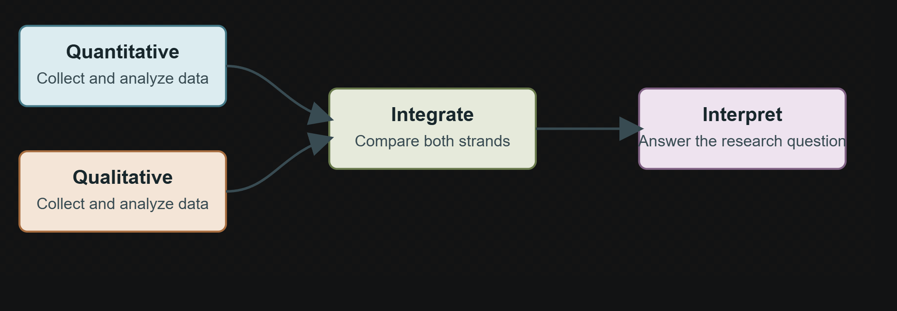

# Abstract {.unnumbered}

Write a concise summary stating the research problem, purpose, approach, main findings, and conclusion. Aim for one page and do not exceed two.

# Preface {.unnumbered}

Write the preface here. End with the place, date, and author name or signature.

# Acknowledgements {.unnumbered}

Optionally acknowledge contributions and support.

# Introduction

Introduce the research topic, explain its relevance, and state the purpose and scope of the thesis.

## Background and motivation

Use Quarto citation keys that match records in `references.bib`.

Citation examples: a parenthetical citation is [@exampleBook], a narrative citation is @exampleArticle, and multiple sources can be cited together [@exampleBook; @exampleArticle]. Replace these illustrative records with sources actually consulted.

Refer to a figure in the text with its Quarto label; for example, @fig-numbering-test-1 refers to the first figure and @fig-numbering-test-2 to the next one.

{#fig-numbering-test-1 fig-cap="First figure-numbering example" fig-alt="A flow diagram showing quantitative and qualitative research strands being integrated."}

{#fig-numbering-test-2 fig-cap="Second figure-numbering example" fig-alt="A flow diagram showing quantitative and qualitative research strands being integrated."}

## Research question

State the central question and any subsidiary questions.

# Literature review

Synthesize relevant research and explain how it informs the research question and the gap addressed by the thesis.

# Methodology

Describe the research design, data, analytical methods, and ethical considerations. @tbl-analysis-overview gives an illustrative summary of how different data strands might be analyzed.

| **Strand** | **Example data** | **Example analysis** |
| --- | --- | --- |
| **Quantitative** | Survey responses | Descriptive statistics |
| **Qualitative** | Interview transcripts | Thematic analysis |

: Illustrative overview of data and analysis by research strand. {#tbl-analysis-overview}

# Results

Present the findings, using Quarto cross-references for figures and tables where appropriate. The short Python example in Code excerpt \textbf{\ref{lst-calculate-mean}} demonstrates a simple descriptive calculation.

```{#lst-calculate-mean .python lst-cap="Calculating a mean from sample values"}
xs = [12, 15, 14, 18]
mean = sum(xs) / len(xs)
print(f"Mean: {mean:.1f}")
```

# Discussion

Interpret the findings in relation to the research question and prior work. Discuss limitations.

# Conclusion

Summarize the main contribution and suggest relevant further work.

# References {.unnumbered}

::: {#refs}
:::

# Declaration on the Use of AI {.unnumbered}

This scientific work has used generative artificial intelligence tools. All data and personal information have been processed in accordance with Oslo Metropolitan University regulations. The author takes full responsibility for the content, claims, and references in this work.

- Generative AI tools were used to summarize research articles to support understanding of the literature.

No AI-generated or AI-rewritten thesis text was used.

```{=latex}
\appendix
```

# Supplementary material

Use appendices for supporting material. For a Long Thesis, include the draft research paper if required. Each top-level heading after `\appendix` starts a lettered appendix.

{#fig-appendix-numbering-test fig-cap="Appendix figure-numbering example" fig-alt="A flow diagram showing quantitative and qualitative research strands being integrated."}

# Additional supporting material

Add material for another appendix here, or remove this heading if it is not needed.
